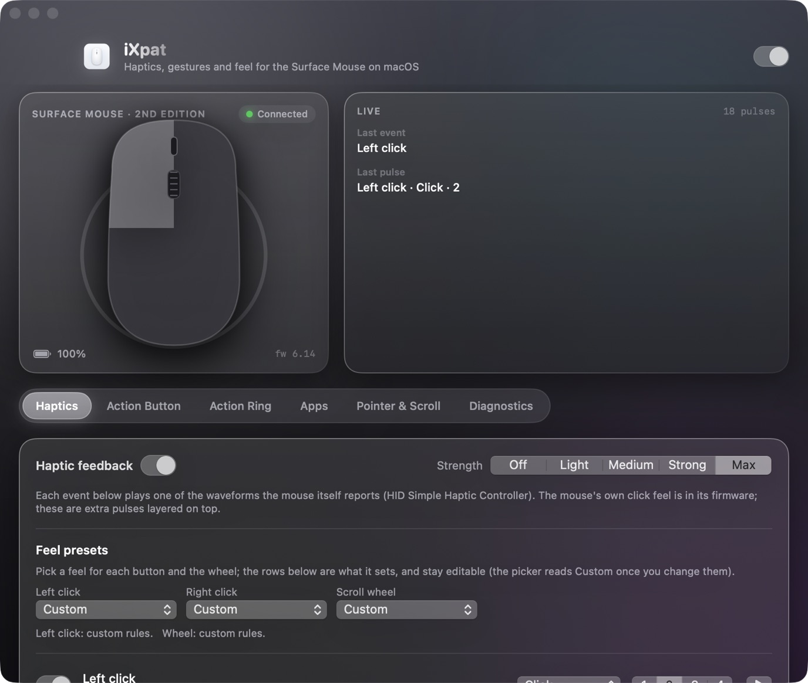

# iXpat

[](https://www.apple.com/macos/)
[](https://knightynite.github.io/ixpat/)

Menu bar app that gives the **Microsoft Surface Mouse (2nd Edition)** on macOS the
feel it has on Windows, and more: haptic feedback for clicks, scrolling, menus and
text selection, an Action Ring, kinetic scrolling, force click, an action button you
can remap, and pointer settings that apply to this mouse only.

The mouse exposes a standard HID *Simple Haptic Controller* (usage page 0x0E), the
same interface the Surface app drives on Windows. macOS has no driver for it, but
user-space IOKit can read the waveform table and fire triggers with no kernel
extension and no private framework. iXpat does that and layers the rest on top.



## Install

### Download

Grab the latest DMG from [Releases](https://github.com/knightynite/ixpat/releases/latest),
open it, drag iXpat to Applications and launch it from the menu bar. On first launch
macOS asks for Input Monitoring and Accessibility (see [Permissions](#permissions)).

### Homebrew

```bash
brew install knightynite/ixpat/ixpat
```

### Build from source

```bash
git clone https://github.com/knightynite/ixpat.git
cd ixpat
./build.sh
cp -r iXpat.app /Applications/
```

Needs Xcode 16+ and macOS 14+.

## What it does

- **Live schematic**: buttons, wheel and action button light up from the mouse's
  own HID reports; every haptic pulse ripples out of the body.
- **Haptics**: a waveform (Click, Hover, Collide, Align, Step, Grow, Success,
  Error, read from the device) and a strength for each event: clicks, wheel
  click, scroll detents, screen edges, drag & drop, window tiling, app switches,
  the action button, menu highlights (menu bar and right-click menus), text
  selection by word and by line, Action Ring detents, free-spin on and off.
- **Dynamic ratchet**: firm detents when scrolling slowly, light quick ticks when
  fast, a firmer bump on reversal, silence in free-spin and a soft pulse when the
  ratchet re-engages.
- **Kinetic scrolling**: each notch is a velocity impulse with friction that
  follows the wheel speed. A slow notch settles crisply at exactly the set
  distance; a flick accelerates and coasts.
  Momentum and acceleration are sliders.
- **Action button**: the firmware sends keyboard chords (press = Win+Shift+S,
  double = Win plus a synthetic left click, hold = Win+Shift+F23). iXpat
  decodes them, hides them from apps, and maps each gesture to an action:
  Action Ring, Mission Control, Spotlight, screenshot, lock, play/pause,
  show desktop, open an app, a shortcut, a shell command.
- **Action Ring**: a radial menu under the pointer with up to
  eight editable chambers and a haptic detent per chamber.
- **Force click**: press and hold the left button for Look Up and link previews,
  with a pulse when it engages (Action Button tab).
- **Pointer & scroll**: tracking speed, no-acceleration, scroll speed and
  reversed scrolling for *this mouse only*; the trackpad is untouched.
- **Feel presets**: named click feels for each button (Subtle, Crisp, Mechanical,
  Deep, Push back, Double tap, Hold & swell, …) and wheel feels (Classic ratchet,
  Fine, Mechanical, Heavy, Coarse, Silk, Slider, Rumble, Silent). A rule can carry a
  second pulse (echo) after a delay; a button held past the hold time plays a swell;
  a free-spinning wheel can keep a faint texture.
- **Hold-and-move gestures**: keep the action button down and move the mouse (the
  pointer stays put). Up/down step the volume or brightness
  with a tick per step and a bump at the end of the range; left/right swipe to the
  previous/next track (or desktops, or any shortcut). Release without moving and the
  hold's own action runs as usual.
- **Hover and control ticks**: a tick when the pointer arrives on a button, tab,
  Dock icon or link (Accessibility hit-test), optionally when the system cursor
  changes shape (resize edges, I-beam), and when a drag crosses a drop target.
- **Front-app notifications**: slider detents (20 per range), tab / list / slide
  selection changes, and an overscroll bump when the scroll bar hits either end,
  from AXObserver on the frontmost app.
- **Per-app profiles** (Apps tab): per bundle id, override haptics on/off, click
  and wheel feel, smooth scrolling, free-spin, the ring and the gestures.
- **Plugin bridge**: a loopback HTTP endpoint (127.0.0.1:47337, token-gated) so
  app plugins can request a pulse by waveform name; see `plugins/`.
- **Diagnostics**: permissions, device identity, haptic table, raw report log.

## Build notes

The first launch opens the settings window
(set `IXPAT_NO_WINDOW=1` to suppress it). `build.sh` signs with a local
codesigning identity when one is present so TCC grants survive rebuilds;
set `IXPAT_SIGN_ID` to pick one, otherwise it falls back to ad-hoc signing.

## Permissions

| Permission | Needed for |
|---|---|
| none | haptic playback, test buttons, waveform table, pointer settings |
| Input Monitoring | reading the mouse's reports: click, wheel and action-button events, screen-edge and drag detection |
| Accessibility | kinetic / reversed scrolling, hiding the button's chord, menu and text-selection ticks, window-tiling detection, firing shortcuts |

Pointer settings go through Apple's `hidutil` and need no permission.

## Updates

iXpat asks the GitHub releases API for a newer version once a day (turn it off
in About iXpat). Nothing else leaves the Mac. A downloaded update opens only if
the DMG carries a valid signature from the release Team ID.

## How the tricky parts work

- The CGEvent tap and the 120 Hz scroll timer run on a dedicated
  user-interactive thread (`TapThread`), never on main, so nothing in the UI can
  delay pointer events.
- Accessibility polling runs on a utility queue. Right-click menus in Chromium
  apps are not in the app's accessibility children and never become the focused
  element; the only reliable way to find the highlighted item is to hit-test the
  element under the pointer (`AXUIElementCopyElementAtPosition`).
- Haptic triggers go out as output report 0x43 `[ordinal, intensity 0–4]` on a
  serial IOKit queue. The device plays one waveform at a time, so the engine
  rate-limits by each waveform's reported duration.

## Website and Windows

The product page lives in `docs/` and is served at https://knightynite.github.io/ixpat/.
A plan for a Windows counterpart (Raw Input + low-level hooks, HID haptics, UI Automation ticks)
and for firmware updates (Microsoft's CFU packages) is in [docs/windows-plan.md](docs/windows-plan.md).

## License

MIT, see [LICENSE](LICENSE). Not affiliated with or endorsed by Microsoft.
Surface is a trademark of Microsoft Corporation.

## Files

    Sources/iXpat/App          app delegate, wiring, debug log, update check
    Sources/iXpat/Device       IOHIDManager device, reports, haptic table
    Sources/iXpat/Haptics      rule engine
    Sources/iXpat/Input        event tap, tap thread, action button, menu watcher, hidutil
    Sources/iXpat/Window       Action Ring panel
    Sources/iXpat/UI           settings window, schematic, menu, theme
    Sources/iXpat/Store        settings model and persistence
    tools/make_icon.swift      renders the app icon

Settings live in `~/Library/Application Support/iXpat/settings.json`; the debug
log and raw report log sit next to it.

## Measured facts (fw 5.29)

Output report 0x43 = `[ordinal, intensity 0–4]`; feature 0x42 = 50 durations
then 50 waveform usages; ordinals 3–10 are Hover (9 ms), Collide (26), Align (9),
Step (11), Grow (200), Success (70), Error (147), Click (11). Two vendor channels
(pages 0xFF07 and 0xFF0B) exist and are not touched; their protocol is unknown
until captured on Windows.
